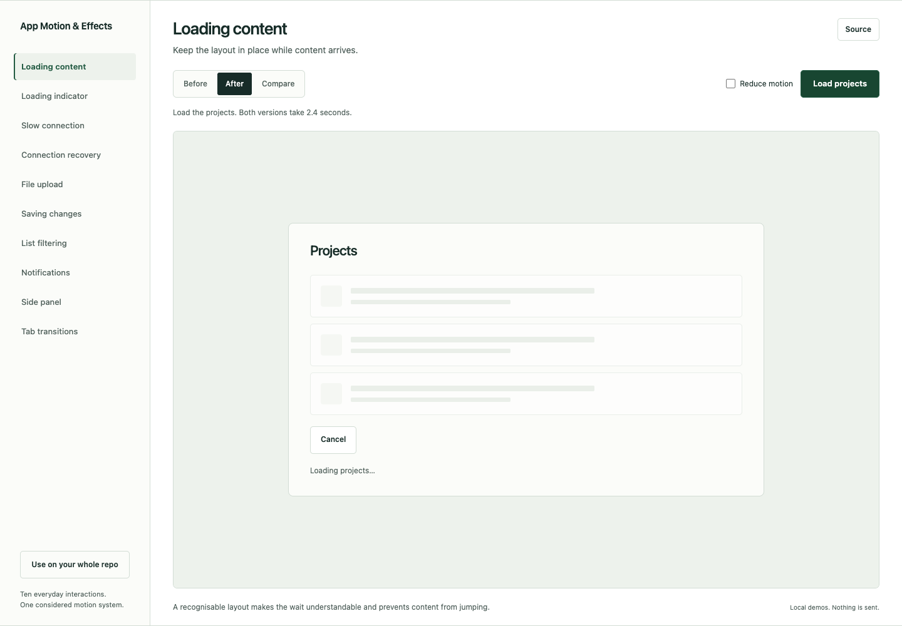
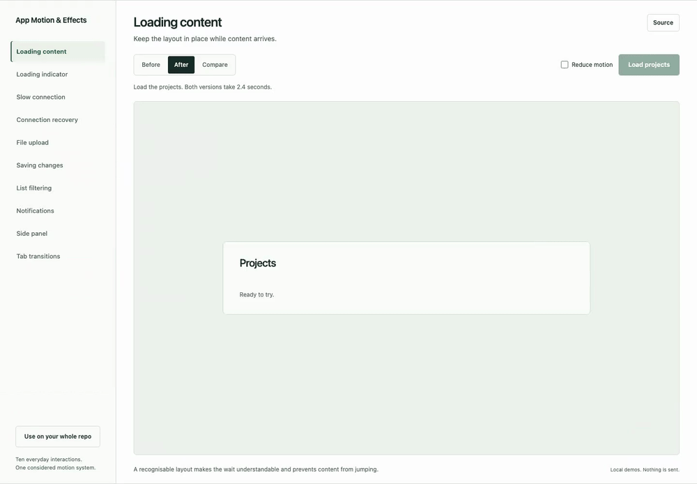

<div align="center">

# App Motion & Effects

### Motion that belongs in your app.

A product-aware skill that guides coding agents to design, implement and verify meaningful animations, transitions and effects **within your existing brand and visual system**.

[**Try the live playground**](https://jagadeeshvarma.github.io/app-motion-effects/) · [Install](#quick-start) · [Full-repo prompt](#full-repository-audit-and-implementation) · [Read the skill](skills/app-motion-effects/SKILL.md) · [Contribute](CONTRIBUTING.md)

[](https://github.com/jagadeeshvarma/app-motion-effects/actions/workflows/checks.yml)
[](https://github.com/jagadeeshvarma/app-motion-effects/actions/workflows/pages.yml)

**Portable Agent Skills format**<br>
MIT licensed · 63 technical categories · 31 source groups · No skill runtime dependencies

</div>

[](https://jagadeeshvarma.github.io/app-motion-effects/)

This audit branch contains an **unreleased 2.1 candidate**. Its capability gate is blocked; the stable 2.0.1 maintenance release is separate. [Measured audit](docs/audit/SKILL_AUDIT.md) · [Rendered evidence](docs/audit/EVIDENCE.md) · [Unchanged runnable outputs](evals/outputs-final/README.md).

## What it does

An operations console, a learning app and a creative canvas need different movement. This skill starts with the customer’s task, the consequences of mistakes and the app’s existing design rules. It then selects and implements an appropriate mechanism, verifies actual playback and checks that the original workflow still works.

- **Fit first.** Frequency, precision, accessibility, device constraints and customer context shape each decision. No invented personas or mandatory “signature” effects.
- **Strict brand fidelity.** Existing tokens, typography, geometry, copy conventions and interaction patterns form an explicit visual contract.
- **Deliberate adaptation.** Research useful mechanisms, reuse suitable libraries or examples, and integrate them with the app’s real components and state. Original code is welcome when it serves the job better.
- **Behaviour survives.** Preserve drafts, focus, permissions and business logic. Handle interrupted, repeated, loading and failed actions.
- **Evidence over claims.** Render and play the result. Test reduced motion, keyboard and relevant touch behaviour. State what remains unverified.
- **Scope stays yours.** Focused fix, app-wide pass, audit or isolated mockup. Invoking a skill does not grant permission to deploy, purchase or mutate accounts.

Sometimes the right decision is to keep the existing interaction or add no animation.

## See it in action

[**Open the examples**](https://jagadeeshvarma.github.io/app-motion-effects/#playground). The workbench fills the viewport: choose an interaction on the left and use the large preview on the right. Start with **After**, switch to **Before**, or choose **Compare** to play both versions together. On mobile, a compact selector keeps the preview in view.

| Example | Try it | What changes |
| --- | --- | --- |
| [Loading content](https://jagadeeshvarma.github.io/app-motion-effects/?example=loading#playground) | Load the projects. | A pulsing skeleton holds the layout, then content settles into place. |
| [Loading indicator](https://jagadeeshvarma.github.io/app-motion-effects/?example=loader#playground) | Prepare a preview. | A continuous indicator communicates an unknown wait without a fake percentage. |
| [Slow connection](https://jagadeeshvarma.github.io/app-motion-effects/?example=slow#playground) | Start a slow load; wait or cancel. | Delayed reassurance, useful cancellation and protection from late responses. |
| [Connection recovery](https://jagadeeshvarma.github.io/app-motion-effects/?example=offline#playground) | Edit a note, disconnect and reconnect. | Loaded content and the draft stay visible through recovery. |
| [File upload](https://jagadeeshvarma.github.io/app-motion-effects/?example=upload#playground) | Upload, pause, resume or cancel. | Measured fixture progress and a drawn completion check. |
| [Saving changes](https://jagadeeshvarma.github.io/app-motion-effects/?example=save#playground) | Edit the title and save, or play the sequence. | A clear pending state and confirmed completion; failures and newer drafts stay accurate. |
| [List filtering](https://jagadeeshvarma.github.io/app-motion-effects/?example=filter#playground) | Filter the projects by status. | Surviving rows move into place while DOM identity and selection remain stable. |
| [Notifications](https://jagadeeshvarma.github.io/app-motion-effects/?example=toast#playground) | Show a confirmation; focus or hover to keep it. | A short entrance, readable dwell and gradual dismissal. |
| [Side panel](https://jagadeeshvarma.github.io/app-motion-effects/?example=panel#playground) | Open details, edit the note and press Escape. | A connected entrance and exit with modal focus and preserved input. |
| [Tab transitions](https://jagadeeshvarma.github.io/app-motion-effects/?example=tabs#playground) | Change views with a click or the arrow keys. | A moving selection indicator and restrained content transition. |

The review shell uses a Scandinavian-inspired minimalist layout, existing paper/green tokens, direct controls and no decorative eyebrow labels or arrow links. Reduced-motion settings preserve the workflow.

[](https://jagadeeshvarma.github.io/app-motion-effects/#playground)

*Actual recorded browser playback: [Loading MP4](docs/media/loading-playback.mp4) · [Saving MP4](docs/media/save-playback.mp4).*

All examples use synthetic content and original HTML/CSS/JS/SVG. Waits, connection loss and uploads are local simulations. No backend, analytics, external fonts, paid assets or additional animation engine. [Evidence and limits](docs/VALIDATION.md).

## Quick start

### 1. Get the source

```sh
git clone https://github.com/jagadeeshvarma/app-motion-effects.git
cd app-motion-effects
```

Prefer a portable ZIP? [Download the latest release](https://github.com/jagadeeshvarma/app-motion-effects/releases/latest). Release assets include SHA-256 integrity records.

The installable skill is **`skills/app-motion-effects/`**. Copy the whole folder, including references and licence. Review an existing same-named installation first; the commands below intentionally stop rather than replace it.

### 2. Install for your agent

**Codex — personal installation**

```sh
mkdir -p ~/.agents/skills
test ! -e ~/.agents/skills/app-motion-effects && \
  test ! -L ~/.agents/skills/app-motion-effects && \
  cp -R skills/app-motion-effects ~/.agents/skills/app-motion-effects
```

**Claude Code — personal installation**

```sh
mkdir -p ~/.claude/skills
test ! -e ~/.claude/skills/app-motion-effects && \
  test ! -L ~/.claude/skills/app-motion-effects && \
  cp -R skills/app-motion-effects ~/.claude/skills/app-motion-effects
```

For project-local use, copy the folder into the **target app’s** `.agents/skills/` (Codex) or `.claude/skills/` (Claude Code). Do not install the same skill independently into overlapping discovery locations. Refresh or start a new agent session and confirm discovery.

These locations follow [Codex skill documentation](https://learn.chatgpt.com/docs/build-skills#where-codex-loads-local-skills) and [Claude Code skill documentation](https://code.claude.com/docs/en/skills). Client versions and managed settings may affect availability. Local Claude Code installation does not automatically install into Claude cloud or Cowork.

**Another coding agent?** Use its documented Agent Skills directory, or give it the entrypoint directly:

```text
Read /path/to/app-motion-effects/skills/app-motion-effects/SKILL.md
and use it for this task. Resolve references relative to that skill folder.
Follow the target repository’s instructions and the authorised task scope.
```

The package uses the [Agent Skills format](https://agentskills.io/specification). `agents/openai.yaml` is optional Codex presentation metadata. No plugin, MCP server, animation library or paid account is required to install it. Tools needed to build and verify an actual app depend on that app and your agent environment.

### 3. Ask for a concrete outcome

**Codex**

```text
Use $app-motion-effects to improve meaningful animations, transitions
and effects in this app. First understand our customers, workflows and
existing visual system. Preserve our branding and business behaviour.
Build and verify an isolated interactive preview. Do not deploy.
```

**Claude Code**

```text
/app-motion-effects Improve meaningful animations, transitions and
effects in this app. Understand our customers and existing visual
system first. Build and verify an isolated preview. Do not deploy.
```

**Focused change, any agent**

```text
Use the app-motion-effects skill to improve only the save interaction
in this form. Preserve its layout, headings, field labels and design
tokens. Verify pending, success, error, edits during save, focus and
reduced-motion behaviour. Do not deploy.
```

<!-- FULL_REPO_PROMPT_START -->
## Full-repository audit and implementation

Install the skill, then paste this into your coding agent to audit the complete active product and implement every justified improvement. Use GitHub’s code-block copy control, or the **Copy full prompt** button on the [examples page](https://jagadeeshvarma.github.io/app-motion-effects/#full-repo-prompt).

```text
Use the installed app-motion-effects skill to perform a complete, application-wide audit, implementation and verification pass across this repository.

Apply the skill thoroughly, including its adaptation guide, complete 63-category taxonomy, source catalogue, verification guidance and review template. Follow its product-awareness, brand-preservation, source-adaptation and evidence requirements.

This is an implementation assignment. Complete the authorised work autonomously and report back when finished. Do not stop at an audit, recommendations, a few mockups or an initial batch of improvements.

SCOPE: THE COMPLETE ACTIVE PRODUCT

Discover every active application, supported platform and shared UI package in this repository.

Inspect all relevant feature areas, routes, screen families, layouts, components, major journeys, roles, permission boundaries, subscriptions and feature flags. Distinguish implemented, planned, incomplete, archived and inaccessible areas.

Inspect both the source and running application where available. Understand the actual customers, tasks, usage frequency, devices and consequences of mistakes before choosing treatments.

Do not restrict the work to the current screen, the most visible pages or one or two interactions.

EXHAUSTIVE COVERAGE, PURPOSEFUL IMPLEMENTATION

Use the skill’s entire taxonomy as a coverage checklist. Assess all 63 categories against the actual product, including animations, transitions, microinteractions, visual and graphic effects, orchestration, interruption behaviour and appropriate sensory feedback.

Identify every place where missing, inconsistent, misleading or poorly implemented behaviour creates a meaningful gap.

Implement every justified improvement within the authorised scope. Do not impose an arbitrary limit on the number of improvements or leave equivalent gaps in secondary screens after fixing the main example.

Preserve good existing behaviour. Mark categories that are irrelevant or would reduce usability as not applicable, with a brief reason. Exhaustive coverage means making an evidenced decision everywhere, rather than forcing every effect into the app.

PAY PARTICULAR ATTENTION TO EVERYDAY STATES

Across every applicable feature, inspect and improve:
- Navigation, content replacement, overlays and responsive changes.
- Loading, skeletons, content reveal and background refresh.
- Slow connections, prolonged waits and timeouts.
- Offline access, connection loss, reconnection and recovery.
- Empty, partial, disabled, permission-denied and expired-session states.
- Forms, validation, saving, success and failure.
- Editing while a request is pending.
- Uploads and genuinely measurable progress.
- Cancellation, explicit retries and uncertain outcomes.
- Optimistic updates and rollback.
- Filtering, sorting, pagination and live data changes.
- Dragging, gestures, direct manipulation and accessible alternatives.
- Repeated input, interrupted playback, stale responses and rapid navigation.
- Foreground/background changes, restoration and cleanup.

Follow the app’s existing business and request semantics. Keep progress and success feedback truthful. Do not invent backend capabilities or present a simulated response as a real result.

Distinguish a cancelled interface wait from a confirmed cancellation of server work. Keep uncertain outcomes honest.

Use percentages only when progress is actually measurable. Use clear indeterminate states when duration or progress is unknown.

Place feedback near the activity. Avoid covering controls or adding duplicate banners. Keep actionable errors visible; give transient confirmations readable dwell time and gradual dismissal where appropriate.

PRESERVE THE APP’S IDENTITY

Establish and verify the visual contract required by the skill.

Use existing branding, tokens, typography, component geometry, iconography, layouts, copy conventions and approved interaction patterns.

Follow the target app’s approved rules for headings, labels and information density. Do not import this skill website’s visual preferences into another product. Remove redundant elements only when justified by the app’s own contract; preserve functional field labels, accessible names and useful instructions.

Tailor the motion direction to this product and its customers. Different journeys may need different emphasis while remaining one coherent application.

Use existing dependencies wherever suitable. Research the mechanisms needed for identified problems using the skill’s source catalogue and additional authoritative sources when useful.

Adapt suitable examples into maintainable app-specific code. Author original implementations where they provide a better fit. Follow the skill’s compatibility, licensing, attribution and provenance requirements.

IMPLEMENT CONSISTENTLY ACROSS THE REPOSITORY

Improve shared primitives and apply them to every relevant consumer. Inspect specialised exceptions instead of assuming one shared change is safe everywhere.

Preserve business behaviour, permissions, drafts, focus, selection, scroll position, record identity and request ownership.

Keep business correctness independent of animation completion. Implement interruption, cancellation, reduced motion and cleanup as part of the interaction.

Preserve unrelated and uncommitted work. Use an isolated branch, worktree or suitable preview area, following repository instructions.

Use synthetic data or authorised test services for demonstrations. Keep prototype controls and simulated operations separate from production services.

VERIFY WHAT USERS ACTUALLY EXPERIENCE

Follow the skill’s verification guidance for all implemented improvements.

Render and play the actual interfaces. Inspect start, intermediate, final, error, recovery and interrupted states. Fix visual and behavioural defects found during review.

Check relevant roles, approved themes, languages, keyboard, pointer, touch, reduced motion and responsive layouts. Verify native behaviour in an actual native runtime where available; state any approximation or limitation.

Check text and button placement, hierarchy, focus, contrast, overlap, clipping, stacking, scrolling, layout shifts and duplicated feedback.

Test slow/offline conditions in isolated test contexts. Verify that cancellation, retries and late responses cannot corrupt current work.

Run the project’s applicable quality gates. Add focused regression tests for meaningful risks without weakening existing checks.

Compare representative performance with the baseline, including rendering work, dependencies, assets and lifecycle cleanup. Report measured results and their limits.

Capture actual screenshots and recordings for important changes. Provide a runnable preview with clear replay steps so the improvements are easy to understand.

MAINTAIN A COMPLETE COVERAGE RECORD

Use the skill’s review template proportionately and maintain a project-local inventory throughout the work.

Give every relevant area and meaningful opportunity a disposition:
- Improved and verified.
- Existing behaviour retained, with evidence.
- Not applicable or not beneficial, with a reason.
- Blocked or unverified, with the exact limitation.

Representative verification is acceptable for genuinely equivalent shared patterns. Identify all affected consumers and separately verify material differences.

Do not claim inaccessible screens were inspected or call the work exhaustive while material coverage gaps remain.

For a large repository, maintain durable checkpoints and continue through context changes. Do not finish after the first batch merely because the task is substantial.

AUTONOMY AND RELEASE BOUNDARIES

Proceed through discovery, research, implementation and verification without asking me to approve routine phases.

Ask only about an unavoidable material ambiguity, missing authority or genuinely blocking access issue. Continue independent work while waiting.

Honour existing explicit release authorisation. Otherwise complete the implementation and verified preview for review without merging or deploying.

COMPLETION AND FINAL RESPONSE

Before finishing, reconcile the completed work against the entire inventory and taxonomy. Address all remaining justified implementation gaps within reach.

Return a concise summary containing:
1. What changed across the product.
2. The preview URL or exact launch instructions.
3. The most useful interactions and states to try.
4. Screenshot and recording links.
5. Coverage totals and a link to the detailed coverage record.
6. Quality-check and representative performance results.
7. Exact blockers, omissions and unverified platforms or roles.
8. The actual release status, when release was authorised.

Keep detailed working notes in project-local files. Let the implemented interfaces and observable evidence carry the review.

Start now and carry this full application-wide pass through to completion.
```
<!-- FULL_REPO_PROMPT_END -->

## How it works

| Step | The agent’s decision |
| --- | --- |
| Understand | Verify product purpose, customer jobs, roles, task frequency, consequences, devices and constraints. Separate facts from assumptions. |
| Preserve | Establish a visual contract from current instructions, approved assets and conservative shipped patterns. |
| Choose | Define purpose, intensity, rhythm, timing, easing, interruption and reduced-motion treatment before browsing effects. |
| Research | Compare at most two serious candidates for a need. Prefer existing tools; inspect current source, compatibility and terms. |
| Build | Adapt mechanisms to actual components, tokens, state and input. Remove demo styling and unnecessary dependencies. |
| Verify | Play, interrupt, resize and exercise states. Check draft/focus preservation, accessibility, performance and contextual fit. |
| Deliver | Provide a reviewable preview, source credits and honest evidence. Respect the user’s release boundary. |

The removal test asks: **what useful information, continuity or permitted experience disappears if this effect is removed?** Cosmetic recolouring alone is insufficient adaptation.

## Coverage and sources

The [63-category taxonomy](skills/app-motion-effects/references/taxonomy.md) covers interface and navigation motion; layout/presence and shared elements; input and gesture feedback; loading/status/data transitions; SVG, typography, particles, 3D and shaders; timing, easing, physics, timelines, state machines and orchestration; plus appropriate haptics, audio, sensors and multimodal feedback.

It is a coverage reference, not a requirement to add every effect.

The [source catalogue](skills/app-motion-effects/references/sources.md) groups resources by mechanism and platform. Examples include:

| Need | Starting points |
| --- | --- |
| Web layout, presence and shared elements | [Motion](https://motion.dev/docs), [View Transitions](https://developer.mozilla.org/en-US/docs/Web/API/View_Transition_API) |
| DOM/SVG timelines and choreography | [Anime.js](https://animejs.com/documentation/), [GSAP](https://gsap.com/docs/v3/) |
| Springs, gestures and manipulation | [React Spring](https://www.react-spring.dev/docs/getting-started), [use-gesture](https://use-gesture.netlify.app/docs/) |
| UI components and interaction patterns | [shadcn/ui](https://ui.shadcn.com/docs/components), [Radix](https://www.radix-ui.com/primitives/docs/guides/animation), [React Bits](https://reactbits.dev/), [Magic UI](https://magicui.design/) |
| Native motion and graphics | [Reanimated](https://docs.swmansion.com/react-native-reanimated/), [React Native Skia](https://wcandillon.github.io/react-native-skia/) |
| Interactive vectors and animation assets | [Rive](https://rive.app/docs/getting-started/introduction), [LottieFiles](https://lottiefiles.com/) |
| Charts, 3D, sensory feedback and other frameworks | [Full catalogue](skills/app-motion-effects/references/sources.md) |

The agent can research beyond this list or author a better-fitting implementation. Links are references, not endorsements, compatibility guarantees or licence grants. External code, assets, editors and runtimes may have different commercial and attribution terms. Web support does not imply native support.

## Develop and contribute

The skill is dependency-free text. The optional website is static; development-only browser tests use Node.js 22+ and Python 3.

```sh
npm ci
npx playwright install chromium
npm test
npm run serve             # http://localhost:4173
npm run package           # dist/ ZIP + SHA-256 manifests
```

The checks validate package structure, local links, portability and interactive example behaviour. Pull requests run the same checks. The Pages workflow validates before publishing. [Contributing guide](CONTRIBUTING.md) · [Code of conduct](CODE_OF_CONDUCT.md) · [Security policy](SECURITY.md).

Useful contributions include a reproducible interaction bug, a well-scoped adaptation improvement, verified platform guidance or a source/licence correction. Explain the customer task and show observed evidence. Keep project-specific brand rules and private data out of this reusable skill.

## Repository map

```text
skills/app-motion-effects/   Installable skill, references and review template
docs/                       Static playground, original demos and rendered media
tests/                      Browser checks for meaningful interaction risks
scripts/                    Portable structure checks and release packaging
.github/                    CI, Pages and contribution templates
```

## Licence and provenance

Original skill text, examples, screenshots and recordings are released under the [MIT licence](LICENSE), copyright Jagadeesh Varma. Keep the licence notice when redistributing. External resources retain their own terms; linking to them does not relicense them. No third-party component source or animation assets are bundled. [Provenance and third-party notices](THIRD_PARTY_NOTICES.md).

Maintained by [Jagadeesh Varma](https://github.com/jagadeeshvarma). Agent-assisted development; human review and application-specific verification remain necessary. No guarantee of identical decisions across agents or complete accessibility conformance.
